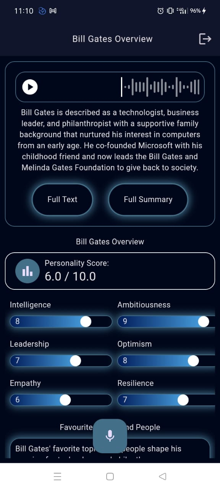

# Alindor Brain AI

## Table of Contents
- [Preview](#preview)
- [Features](#features)
- [Challenge](#challenge)
- [Project Dependency](#dependency)
- [Project Structure](#structure)
- [How to Setup](#setup)
- [Prerequisites](#prerequisites)
- [Installation](#installation)
- [Running the Project](#running-the-project)
- [How to interect](#interact)

## Preview

Download the Apk

You can download the latest version of the app from the following link:
- [Download APK]()

<table>
  <tr>
    <td>
    <p>Alindor BrainAi App built With Flutter<br/>
      </p>
    </td>
  </tr>
</table>



## Features
|   | Feature |
|---|-----------|
| ✔️ | Speech to Text |
| ✔️ | Text Analysis |
|  | UI Enhancement |
|  | Implement firestore db  |

## Challenge
- Keeping JSON Consistent in Open AI was a challenge which has been solved via gpt function.

## State Management: BLoC

BloC | MVP

#### Versions

- [flutter_bloc](https://pub.dev/packages/flutter_bloc) - version 8.1.5

## Dependency
- Flutter: 3.19.3
- Java: 20.0.2

## Structure
Project Structure
```
├── app.dart
├── application
│   └── routes
├── core
│   ├── network
│   ├── theme
│   ├── utils
│   └── widgets
├── di_module.dart
└── features
    ├── auth
    │   ├── data
    │   │   ├── datastore
    │   │   └── model
    │   ├── domain
    │   └── presentation
    │       ├── bloc
    └── ind_record
        ...
```

# Setup
How to setup

## Prerequisites

Before you can set up and run this project locally, ensure that you have the following prerequisites installed on your machine:

- Flutter SDK [Install Flutter](https://flutter.dev/docs/get-started/install)

## Installation

1. Clone this repository to your local machine using the following command:

```git clone https://github.com/your-username/project-name.git```

2. Navigate to the project directory:

```cd alindor_brainai```

3. Install the project dependencies by running the following command:

flutter pub get

## Running the Project

To run the project locally, follow these steps:

1. Ensure that you have a simulator/emulator or a physical device connected to your machine.

2. Start the simulator/emulator or connect your physical device.

3. Run the project using the following command:

```flutter run```

This will build and launch the app on the connected device.

## Interact
How to interect with each operation:
1. Home View:
    - Sign in with your firebase
2. IndRecord Page
    - Tap the record button say something (at least 1 minute recommended)
    - Press stop and wait for the loading to finish
    - Voila! View your result


## Getting Started with Flutter?

This project is a starting point for a Flutter application.

A few resources to get you started if this is your first Flutter project:

- [Lab: Write your first Flutter app](https://docs.flutter.dev/get-started/codelab)
- [Cookbook: Useful Flutter samples](https://docs.flutter.dev/cookbook)

For help getting started with Flutter development, view the
[online documentation](https://docs.flutter.dev/), which offers tutorials,
samples, guidance on mobile development, and a full API reference.
